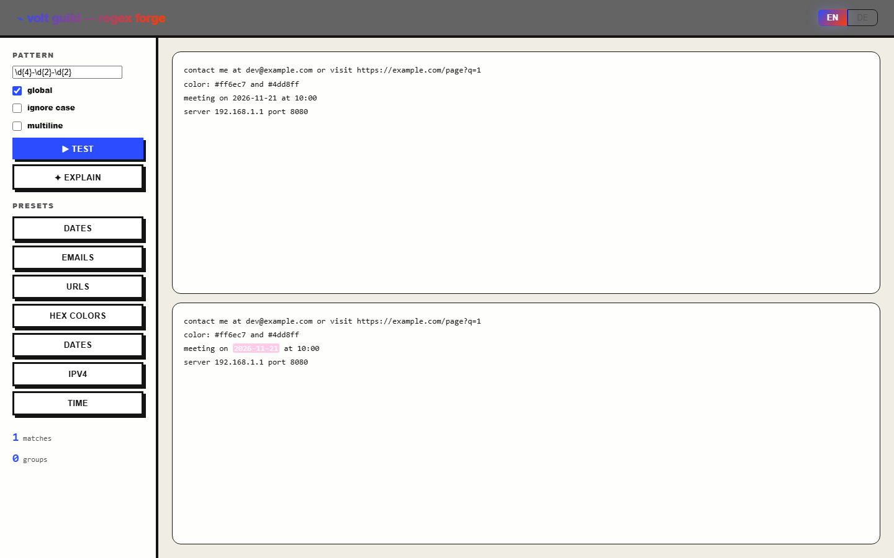
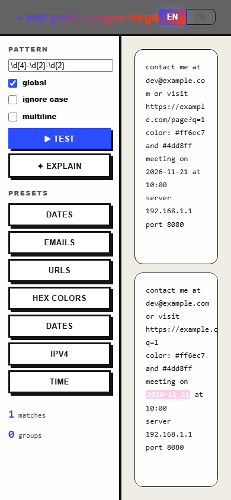

# Volt Guild — Regex Forge

A live regex workbench with 7 built-in presets (emails, urls, dates, ipv4…), match highlighting, group counting and flag toggles.

<div align="center">


**[Live Demo](https://ruslanfridenli.github.io/volt-guild/)** · **[Deutsch ↓](#-deutsch)**

</div>

---

## Screenshots






## Features

- Live match highlighting in the input text
- 7 built-in pattern presets
- Global/case-insensitive/multiline flags
- Match and capture-group counting
- Instant feedback on regex errors
- English/German interface

## Local development

```bash
git clone https://github.com/ruslanfridenli/volt-guild.git
cd volt-guild
# open index.html in a browser, or serve statically:
npx serve .
```

No build step, no dependencies — pure static site.

---

## 🇩🇪 Deutsch

### Volt Guild — Regex Forge

Eine Live-Regex-Werkbank mit 7 eingebauten Presets (E-Mails, URLs, Daten, IPv4…), Match-Highlighting, Gruppen-Zählung und Flag-Schaltern.

### Funktionen

- Live-Match-Highlighting im Eingabetext
- 7 eingebaute Pattern-Presets
- Flags für global, Groß-/Kleinschreibung, mehrzeilig
- Zählung von Treffern und Capture-Gruppen
- Sofortiges Feedback bei Regex-Fehlern
- Englische/deutsche Oberfläche

### Lokale Entwicklung

```bash
git clone https://github.com/ruslanfridenli/volt-guild.git
cd volt-guild
npx serve .
```

Reine statische Seite — kein Build-Schritt, keine Abhängigkeiten.

---

## ☕ Support / Unterstützen

Wenn dir diese Website beim Lernen hilft, würde mir eine Spende sehr viel bedeuten und dabei helfen, sie weiterzuentwickeln. Alternativ kannst du das Projekt mit einem Stern im github repo unterstützen. Vielen Dank!

- Solana: `zQpgZ6nGigww7vYpz3Qqxb1BT44kqS567vFaLTeHagS`
- Ethereum: `0x9c4fE1B2e9a1A9c22312c8296BB088Ca0e8F1B4e`
- Bitcoin: `bc1p2jltk9ya9kyzv35d8kxn7mmg9jqkx66cqtgzqwe75zlr4v9jk4hsv468q7`

---

Made with care. Feedback welcome via issues.
